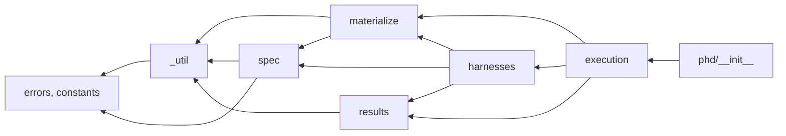
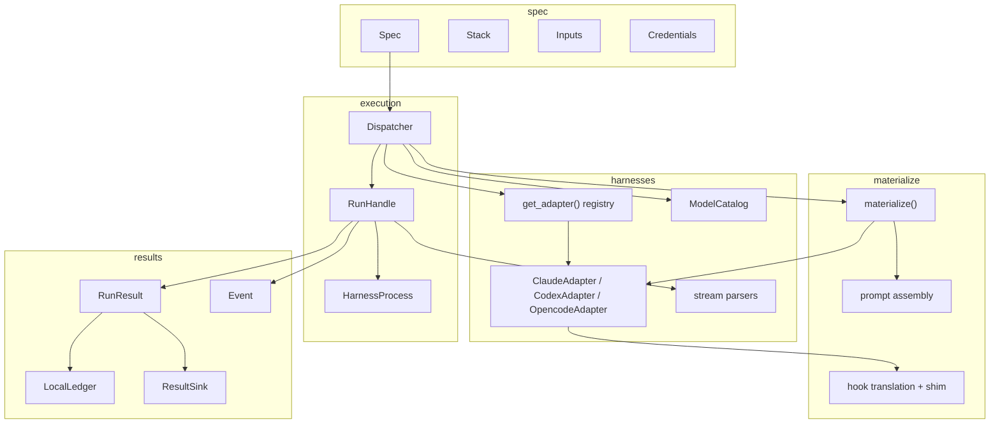
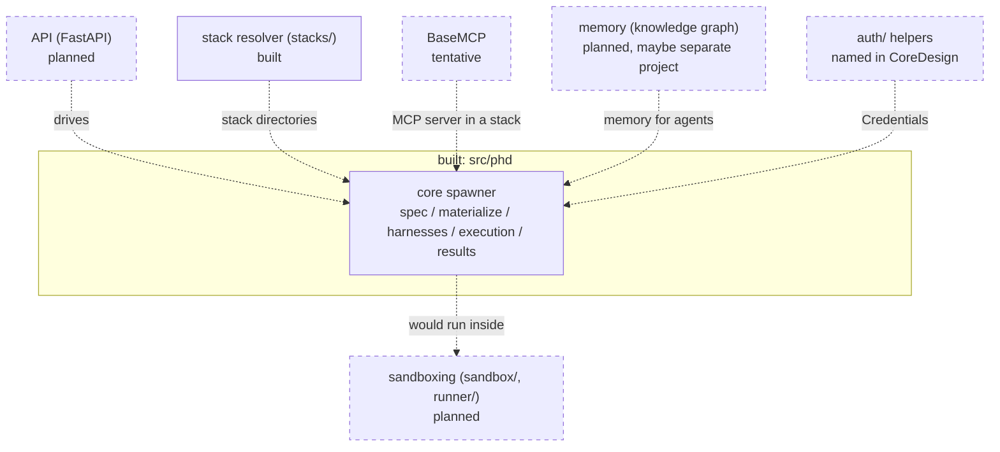

# Architecture

This page describes how the built core spawner is organised (package layout, dependency order, import rule,
components and data flow) and then places it among the planned components, which are recorded as intent only.

The design record is [CoreDesign.md](CoreDesign.md). Where it and the code differ, the code (and these pages) are
current.

## Package layout

```
src/phd/
  __init__.py        public re-exports only (phd.__all__) and __version__
  errors.py          the PhdError taxonomy
  constants.py       harness names, modes, neutral events/tools, REDACTED
  runs.py            re-export so `import phd.runs` works (implementation: results/runs.py)

  _util/             stdlib-only helpers; imports nothing from phd except errors
    fs.py              write_json, write_json_atomic, write_private, deep_merge, robust_rmtree, is_within
    names.py           is_safe_part (portable folder names: stack name / version)
    proc.py            pid_alive
    env.py             clean_env, HOST_ENV_PREFIXES (the stripped environment of every harness process)
    paths.py           phd_cache_dir (`$PHD_CACHE_DIR`, default ~/.phd/cache)
    shell.py           shell_join (hook command lines), resolve_argv (PATH lookup, .cmd shims)
    toml.py            minimal TOML writer for codex config.toml
  stacks/            compose, resolve and store stacks (uses spec and _util only)
    __init__.py        resolve, get, list, remove, prune, compose, load_manifest, Manifest, ComponentSource
    manifest.py        Manifest, ComponentSource, stack.toml parsing, compose()
    sources.py         fetch local / http(s) sources, unpack archives safely
    assemble.py        build config/ from a manifest: clash rules, ${here}, stack.json
    store.py           the store: index.json, identity hash, dedupe, locking, list/remove/prune
  spec/              what to run
    spec.py            Spec, Inputs
    output_schema.py   output_schema checks, JSON extraction and validation (the only module that imports jsonschema)
    credentials.py     Credentials
    stack.py           Stack, HookDef
    placeholders.py    ${stack} / ${env:NAME} resolution
  results/           what came out
    model.py           RunResult, RunStatus, RunError, Usage, Event, decide_status
    ledger.py          LocalLedger, ResultSink
    session.py         SessionRef (where a session can be resumed from)
    runs.py            list() / get() over the default ledger
  materialize/       the pure step: write a run home, run nothing
    __init__.py        materialize(adapter, spec, inputs, *, run_id, run_dir, home=None)
    context.py         MaterializeContext (handed to adapters), MaterializedHome (returned)
    prompt.py          assemble()
    hooks/             translate.py, opencode_plugin.py, runtime.py, shim.py (copied into each home)
  harnesses/         one sub-package per CLI
    __init__.py        get_adapter() registry, ModelCatalog, Outcome
    base.py            Adapter and StreamParser protocols
    outcome.py         Outcome, classify_error, as_int
    catalog.py         ModelCatalog
    schema_wrap.py     wrap / unwrap a non-object output_schema (claude, codex)
    summary.py         shared Event.summary formatting (finish, tool_line, outcome_line)
    claude/ codex/ opencode/   adapter.py, parser.py, models.py (codex also schema.py: strict-mode output_schema)
  execution/         launching and driving runs
    dispatcher.py      Dispatcher
    handle.py          RunHandle
    process.py         HarnessProcess, child_env
    session_lock.py    SessionLock: one run at a time per run home
    lifetime/          tie each harness to its caller (orphan protection)
      __init__.py        Guard protocol, new_guard(), CREATE_SUSPENDED
      windows_job.py     JobGuard: Job Object with kill-on-close; harness created suspended, assigned, resumed
      reaper.py          ReaperGuard (POSIX): starts the reaper and tells it `exit` on a normal finish
      reaper_main.py     the reaper process; stdlib only, imports nothing from phd
```

PHD has **one runtime dependency**, `jsonschema`, imported only in `spec/output_schema.py`; everything else is the
standard library. `_util` stays stdlib-only, and `lifetime/reaper_main.py` is a standalone script that imports
nothing from `phd`.

## Dependency order and import rule

A package imports only from packages to its left:

```
errors, constants  <-  _util  <-  spec, results  <-  stacks  <-  materialize  <-  harnesses  <-  execution  <-  phd/__init__
```

Simplified diagram of the main edges (it omits, for example, `harnesses` → `_util`, `execution` → `_util` and
the many imports of `constants`); the rule above is authoritative.



- `materialize()` takes the adapter as an argument instead of looking it up, so `materialize` never imports
  `harnesses` at runtime; adapters import `materialize` (context and hook helpers), and `execution` wires the two.
- `results` depends only on `_util` and `errors`, so `harnesses.outcome` can use `Usage` and `RunError`.
- Cross-package imports go through the sub-package's `__init__` (`__all__`). Reaching into a submodule is
  reserved for names that are deliberately not exported (for example `results.model.decide_status`,
  `spec.placeholders.resolve`). Within a package, siblings import each other directly.

## Components



The five layer-1 components of the design map to code like this:

| Design component | Code |
|---|---|
| (a) Spec | `spec/spec.py` `Spec`, `spec/credentials.py` |
| (b) Stack | `spec/stack.py` |
| (c) Materializer | `materialize/` + each adapter's `materialize(ctx)` |
| (d) Launcher | `execution/process.py` `HarnessProcess`, `_util/shell.py` |
| (e) Collector | each harness's `parser.py` + `execution/handle.py` |

## Data flow

How the data changes shape from caller to ledger:

| Stage | In | Out |
|---|---|---|
| `Stack.load` | `config/` directory | `Stack` (identity text, skill paths, unresolved MCP servers, `HookDef`s) |
| `Spec(...)` | fields | validated `Spec` |
| `Dispatcher(spec)` | `Spec` | adapter, ledger, `warnings` |
| `materialize` | `Spec`, `Inputs`, run dir | run home on disk, `MaterializedHome` (`argv`, `env`, `stdin`, `warnings`); `run.json` |
| launch | `MaterializedHome` | child process (stdin = first user message) |
| parse | stdout JSON lines | `Event`s (`events.jsonl`) and an internal `Outcome` |
| build result | `Outcome`, exit code, timeout/budget/cancel flags | `RunResult` |
| sinks | `RunResult` | `result.json`, plus whatever extra sinks do |

## Roadmap components

> Item 1 (the stack resolver) is **built**. Everything else in this section is **PLANNED, NOT DESIGNED**: it records
> the owner's stated intent and the open questions. None of it exists in the code, and none of it is a design decision.



### 1. Core spawner (built)

What exists: everything documented on the other pages.

The **stack resolver** is built: `phd.stacks` composes a stack from local paths and URLs (a base stack plus
individual skills, MCP servers and hook bundles), keeps it in a local store and deduplicates by content. It
produces an ordinary `Stack`, so the core is unchanged. See [Stack resolver](concepts/stack-resolver.md).

Still open: content verification (hash pins, signatures; CoreDesign mentions signed tarballs as a later-layer
idea), a download cache, a registry, and shipping stacks into a sandbox.

### 2. API

Intent: a **FastAPI** surface that drives the spawner.

Open questions: which operations it exposes (plan / start / resume / cancel / runs); how events are streamed to
clients; authentication; where runs and the ledger live; how it relates to the in-sandbox runner below.

Where it would sit: a separate package or service on top of `Dispatcher` / `RunHandle`; `phd` itself has no HTTP
dependency today.

### 3. BaseMCP (tentative)

Intent: a set of MCP tools the agent itself uses for

- **(a) chatting with the user**: when an agent is spawned with a `msg` / `brief`, its responses are surfaced
  somewhere the user can see and answer;
- **(b) artifact management**: the agent marks files (plans, research results) as *artifacts* that the user can
  fetch easily, especially when the agent runs remotely or in a container.

Open questions: where chat messages surface and how a headless run waits for a reply; artifact storage and
retrieval (and how artifacts relate to the run directory and sandbox persistence); whether BaseMCP is added to
every stack automatically or declared per stack.

Where it would sit: delivered as an MCP server; the existing stack `.mcp.json` mechanism and `${stack}` /
`${env:NAME}` placeholders are the current way to give an agent MCP tools.

### 4. Sandboxing

Intent: run agents inside a **container and/or microVM** (undecided), with usage along the lines of a
`with sandbox:` block; sandboxes are **reproducible on demand** (same filesystem, persisted artifacts) and can be
**fully torn down**.

Open questions: container vs microVM (or both); the shape of the `with sandbox:` API and how it composes with
`Dispatcher`; what persists between uses; network policy; how credentials enter the sandbox. CoreDesign's
"Agreed for later layers" list records earlier context (Docker Engine API backend first, named persistent
sandboxes, a `harness_only` network allowlist by default, an in-sandbox `phd-runner`), but no sandbox design
exists yet.

Where it would sit: sibling packages `sandbox/` (isolated execution environments) and `runner/` (the
in-sandbox API wrapping this same core), both named in CoreDesign.

### 5. Memory

Intent: **knowledge-graph-based project/agent memory**, plug-and-play between agents; possibly a separate
project.

Open questions: storage and schema; how an agent reads and writes it (for example as an MCP server in a stack);
scoping per project vs per agent; whether it lives in this repository.

### Seams the current code already provides

| Seam | What it allows | Where |
|---|---|---|
| Location-agnostic core | The core takes paths and returns a `RunResult`; it knows nothing about Docker, sandboxes or HTTP, so a runner or API can wrap it unchanged | `Dispatcher`, `RunHandle` |
| `ResultSink` | Push results to another store (database, API, message bus) alongside the local ledger | `Dispatcher(sinks=[...])`, `results/ledger.py` |
| Adapter registry | Add a harness by implementing the `Adapter` / `StreamParser` protocols (the parser must implement `summarize` for `Event.summary`) and registering it | `harnesses/__init__.py` `_ADAPTERS`, `harnesses/base.py` |
| `materialize(adapter, spec, inputs, *, run_id, run_dir)` | A pure step that writes a run home anywhere (for example inside a sandbox volume) without launching | `materialize/__init__.py`; `Dispatcher.plan` |
| `runs_root` | Put run directories wherever the environment needs them | `Dispatcher(runs_root=...)` |
| `executables` | Point a harness at a specific binary or wrapper command | `Dispatcher(executables=...)` |
| `RunResult.sandbox` | Field reserved for recording the sandbox a run used (always `None`) | `results/model.py` |
| `Credentials` value object | Credential acquisition (CoreDesign's `phd auth login/status` helper, a future `auth/` package) can produce `Credentials` without changing the core | `spec/credentials.py` |
| Async event stream | `RunHandle.events()` can be forwarded by an API | `execution/handle.py` |

---

**Next:** [Troubleshooting](troubleshooting.md) · **See also:** [Design record](CoreDesign.md), [Run lifecycle](concepts/run-lifecycle.md), [API reference](reference/index.md)
