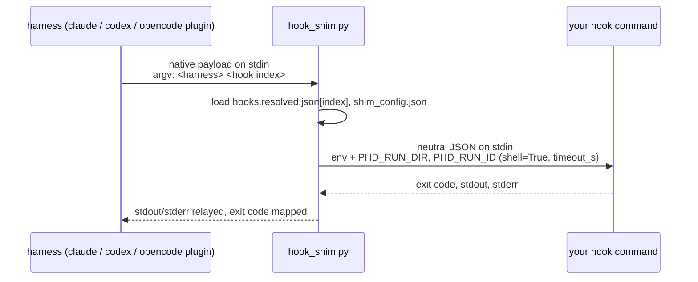

# Hooks

This page covers neutral hooks: the event and tool vocabulary, how each harness's native hook system is wired to
it, the shim that translates payloads, the payload your hook command receives, exit-code semantics, the opencode
plugin, and the limitations.

A stack declares hooks once, in harness-neutral terms (`hooks/hooks.json`, see
[Stacks](stacks.md#hookshooksjson-neutral-hooks)). At materialize time PHD writes the harness's native hook
configuration, and every native hook calls the same small Python script, the **shim**, which converts the
harness's payload to the neutral shape and runs your command.



## Neutral events

| Neutral event | Meaning | claude | codex | opencode |
|---|---|---|---|---|
| `session_start` | run begins | `SessionStart` | `SessionStart` | not supported (`HookUnsupported`) |
| `pre_tool` | before a tool call; can block | `PreToolUse` | `PreToolUse` | plugin `tool.execute.before` |
| `post_tool` | after a tool call | `PostToolUse` | `PostToolUse` | plugin `tool.execute.after` |
| `stop` | agent finishes | `Stop` | `Stop` | not supported (`HookUnsupported`) |

## Neutral tools (`match.tool`)

Without `match.tool` a hook fires for every tool. With it, PHD translates the neutral name to the native matcher;
a name that has no translation for the harness raises `HookUnsupported` when the `Dispatcher` is created.

| Neutral tool | claude matcher | codex matcher | opencode tool |
|---|---|---|---|
| `shell` | `Bash` or `PowerShell` (†) | `Bash` | `bash` |
| `read` | `Read` | unsupported | `read` |
| `write` | `Write` | unsupported | `write` |
| `edit` | `Edit` or `MultiEdit` (†) | unsupported | `edit` |
| `web_fetch` | `WebFetch` | unsupported | `webfetch` |
| `web_search` | `WebSearch` | unsupported | unsupported |
| `mcp:<server>/<tool>` | `mcp__<server>__<tool>` | unsupported | unsupported |
| `mcp:<server>` | `mcp__<server>__.*` | unsupported | unsupported |

(†) One entry whose matcher is the regex `Bash|PowerShell` (Claude Code on Windows runs shell commands through its PowerShell tool) or `Edit|MultiEdit`. Only `shell` is verified for codex; other codex tool
names are unknown, so they are rejected rather than guessed.

## Per-harness translation

**claude and codex** share Claude's hook schema. Each neutral hook becomes one entry under its native event:

```json
{"PreToolUse": [{"matcher": "Bash|PowerShell",
                 "hooks": [{"type": "command",
                            "command": "C:/path/python.exe C:/runs/<id>/home/phd/hook_shim.py claude 0",
                            "timeout": 10}]}]}
```

- claude: under `hooks` in `home/settings.json`. codex: `home/hooks.json` as `{"hooks": {...}}`, and the run gets
  `--dangerously-bypass-hook-trust`.
- `command` = the Python interpreter running PHD (`sys.executable`), the shim path, the harness name and the hook's
  index. Arguments are quoted only when they contain whitespace or `& | < > ^ ( )`. For codex on Windows, if the
  command starts with a quote, it is wrapped in one more pair of quotes (cmd.exe `/C` strips one pair).
- `timeout` = `ceil(timeout_s)` seconds (the harness's own limit); the shim applies `timeout_s` to your command
  too.

**opencode** gets a generated plugin; see [below](#opencode-plugin).

## Runtime files

`write_runtime` puts these in `home/phd/` when the stack has hooks:

| File | Contents |
|---|---|
| `hook_shim.py` | copy of `src/phd/materialize/hooks/shim.py` (standard library only) |
| `hooks.resolved.json` | the hook list with `${stack}` (shell-quoted) and `${env:NAME}` resolved |
| `shim_config.json` | `{"run_id": ..., "run_dir": ...}` |

## Payload your command receives (stdin)

| Key | claude / codex | opencode `pre_tool` | opencode `post_tool` |
|---|---|---|---|
| `event` | neutral event | `"pre_tool"` | `"post_tool"` |
| `harness` | `"claude"` / `"codex"` | `"opencode"` | `"opencode"` |
| `tool` | neutral name (below), or `null` for events without a tool | neutral name | neutral name |
| `input` | native `tool_input` | the tool's `args` | absent |
| `output` | native `tool_response` (`null` before the tool runs) | absent | the tool's `output` |
| `cwd` | native `cwd` | the plugin's `directory` | the plugin's `directory` |
| `run_id` | PHD run id | PHD run id | PHD run id |

Tool names in the payload are mapped back to neutral names: claude/codex `Bash` and `PowerShell` → `shell`,
`Read` → `read`, `Write` → `write`, `Edit` and `MultiEdit` → `edit`, `WebFetch` → `web_fetch`,
`WebSearch` → `web_search`, `mcp__<server>__<tool>` → `mcp:<server>/<tool>`; opencode `bash` → `shell`,
`webfetch` → `web_fetch`, `read` / `write` / `edit` unchanged. Any other tool keeps its native name
(for example claude `Glob`).

Environment: whatever the harness gives the hook process, plus `PHD_RUN_DIR` (the run directory) and `PHD_RUN_ID`.
The command runs through the system shell (`shell=True`: `cmd.exe` on Windows, `/bin/sh` on POSIX). The shim
copies your command's stdout and stderr to its own. For claude/codex the harness reads that stdout, so a hook can
emit harness-native JSON (not portable across harnesses). The opencode plugin ignores stdout.

Example hook (from the test stack) that logs every shell call and blocks `rm -rf`:

```python
import json, os, sys
evt = json.load(sys.stdin)
with open(os.path.join(os.environ.get("PHD_RUN_DIR", "."), "hook.log"), "a", encoding="utf-8") as f:
    f.write(json.dumps(evt) + "\n")
if "rm -rf" in json.dumps(evt.get("input", {})):
    print("blocked by guard.py: rm -rf is not allowed", file=sys.stderr)
    sys.exit(2)
sys.exit(0)
```

## Exit codes

What the shim returns to the harness:

| Situation | `pre_tool` | `session_start`, `post_tool`, `stop` |
|---|---|---|
| your command exits 0 | 0 (allow) | 0 |
| your command exits 2 | **2 (block; stderr is the reason)** | 1 |
| your command exits with any other code | 1 | 1 |
| your command times out (`timeout_s`) | 2 | 1 |
| your command cannot be started, or the shim fails unexpectedly | 2 | 1 |
| stdin is not valid JSON / not an object | 2 | 1 |
| shim arguments invalid, `hooks.resolved.json` or `shim_config.json` unreadable | 2 | 2 |

Two rules follow from this:

- **`pre_tool` is fail-closed for shim-level failures.** A hook that times out or cannot run blocks the tool.
  But a hook script that itself crashes usually exits 1 (a Python traceback does), and exit 1 does **not** block
  in claude or codex (it is a non-blocking error). Exit with 2 explicitly to block.
- **Outside `pre_tool`, 2 becomes 1.** A claude `Stop` hook exiting 2 would make the agent continue, so a neutral
  `stop` hook cannot do that. The exception is the last row, where the shim returns 2 before it knows the event.

How each harness treats 1 vs 2 is the harness's behaviour; PHD only guarantees the mapping above. On codex a
blocked call is reported as "rejected: blocked by policy" without your reason.

## opencode plugin

For opencode, PHD writes `home/config/plugin/phd-hooks.js` (opencode loads plugins from `OPENCODE_CONFIG_DIR`).
It embeds the hook list (`index`, `event`, `tool`), the native-to-neutral tool map, the interpreter path and the
shim path, and registers:

- `tool.execute.before`: for each `pre_tool` hook whose `tool` is unset or equals the neutral tool, runs
  `python hook_shim.py neutral <index>` with the neutral payload (via `Bun.spawnSync`); exit code 2 throws an
  `Error` with the shim's stderr (or `blocked by PHD hook`), which blocks the tool. Other exit codes are ignored.
- `tool.execute.after`: runs each matching `post_tool` hook; the result is ignored.

The shim receives the neutral payload already shaped by the plugin and passes it through (adding `run_id`).

## Limitations

- opencode: no `session_start` / `stop`.
- codex: only `shell` can be matched; the block reason is not shown to the agent.
- Unmapped native tools reach hooks under their native names, so a hook without `match` sees harness-specific
  names for them.
- The hook configuration embeds the absolute path of the Python interpreter that created the run. If that
  environment is removed, hooks of a later resume fail (and fail closed on `pre_tool`).
- Hook commands run on the host with the harness's environment; they are not sandboxed.

---

**Next:** [Run lifecycle](run-lifecycle.md) · **See also:** [Stacks: hooks.json](stacks.md#hookshooksjson-neutral-hooks), [Harnesses](harnesses.md)
