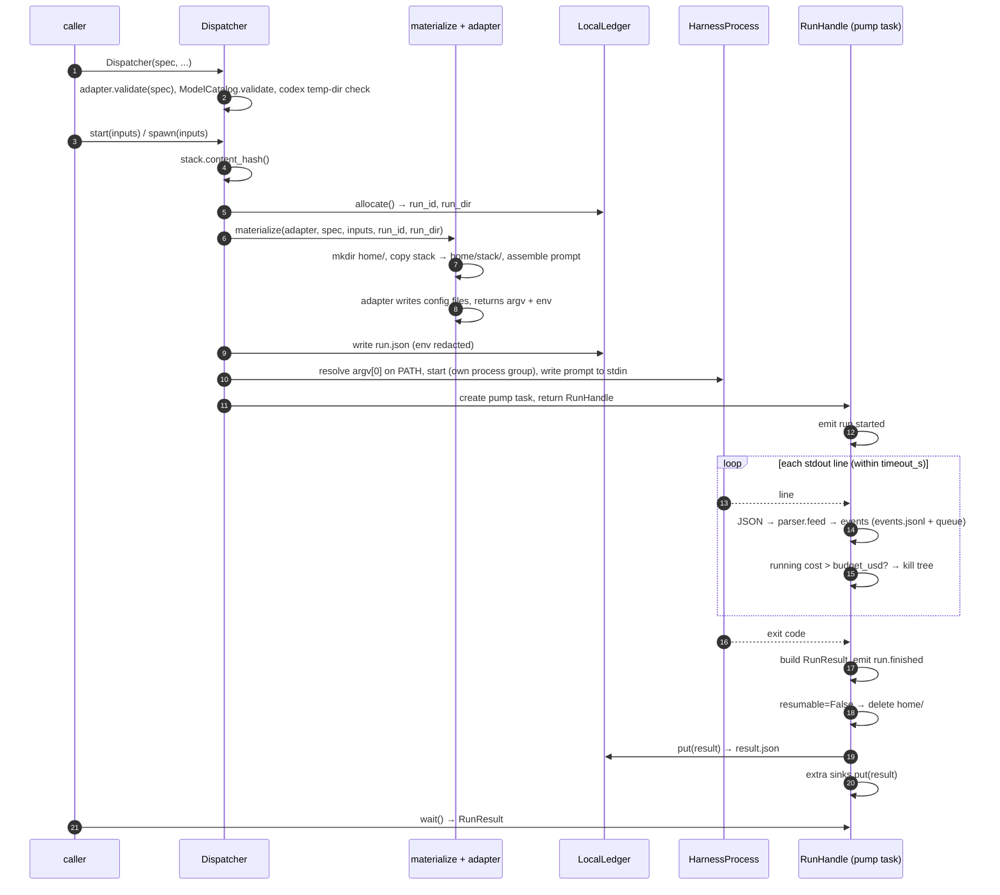
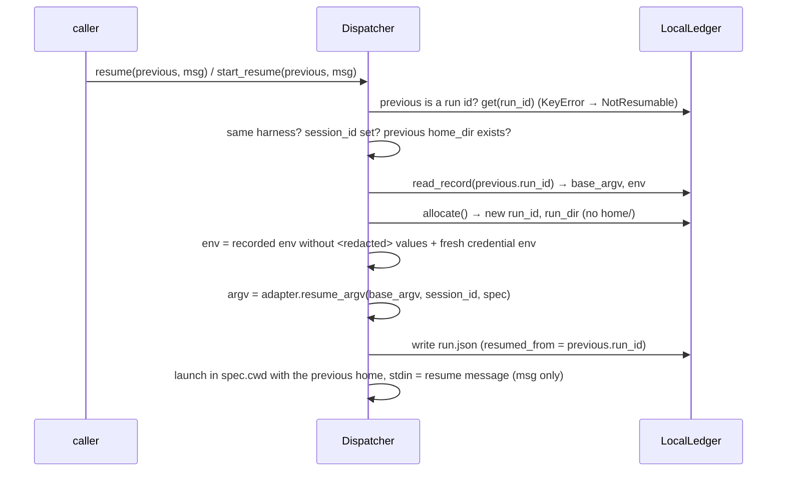

# Run lifecycle

This page follows one run from `Dispatcher(...)` to the ledger: validation, planning, materialization, launch,
stream parsing, result and sinks; the run-directory layout; the resume flow and what must persist for it; and how
cancel, timeout, budget, stream overflow and interrupts end a run.

## Overview



## Steps

| # | Step | Code | Can raise (pre-launch) |
|---|---|---|---|
| 1 | **Validate** in `Dispatcher.__init__`: adapter checks (hooks, output_schema, warnings), model catalogue, codex temp `runs_root` | `execution/dispatcher.py` | `HookUnsupported`, `UnsupportedFeature`, `ModelNotSupported`, `InvalidRunsRoot` |
| 2 | **Plan**: hash the stack (pinned now: this is what runs), allocate `<runs_root>/<run_id>/` | `Dispatcher._plan` | `OSError` |
| 3 | **Materialize**: create `home/`, copy the whole stack to `home/stack/`, assemble the prompt, let the adapter write its files and return `argv` and `env`; write `run.json` | `materialize/__init__.py`, adapters | `MissingCredentials`, `MissingSecret` |
| 4 | **Launch**: resolve `argv[0]` (or use `executables[harness]`), start the process in `Spec.cwd` with the stripped host env plus `env`, stdout/stderr piped, stdin written in the background | `RunHandle.launch`, `execution/process.py` | `HarnessNotInstalled` |
| 5 | **Stream / parse**: read stdout line by line; non-JSON lines become `log` events; JSON objects go to the harness parser, which yields normalized events and accumulates the outcome; stderr is copied to `stderr.log` | `RunHandle._consume` | never (data) |
| 6 | **Result**: decide the error (precedence below), build `RunResult`, emit `run.finished`; delete `home/` if `resumable=False` | `RunHandle._build_result` | never (data) |
| 7 | **Sinks**: `LocalLedger.put` writes `result.json` atomically, then each extra sink | `RunHandle._pump` | never: sink errors become warnings |

`plan(inputs)` runs steps 2 and 3 only. Note that a `HarnessNotInstalled` at step 4 leaves a run directory with
`run.json` and `home/` but no `result.json`.

## Run directory

```
<runs_root>/<run_id>/          runs_root defaults to ~/.phd/runs; run_id = YYYYmmdd-HHMMSS-<6 hex> (local time)
  run.json                     launch record, written before launch (also by plan())
  events.jsonl                 one normalized Event per line
  stderr.log                   the harness's stderr, raw
  result.json                  the RunResult, written after the run
  home/                        the isolated config home (absent for resumed runs and after resumable=False)
```

| File | Written by | Contents |
|---|---|---|
| `run.json` | `Dispatcher` (plan / start / start_resume) | `run_id`, `harness`, `model`, `cwd`, `argv`, `base_argv` (the fresh-run argv, used to build resume commands), `env` (values of names matching `TOKEN`, `KEY`, `AUTH_CONTENT`, `SECRET`, `PASSWORD` replaced by `<redacted>`), `stdin` (the full first message), `warnings`, `resumed_from`, `home` |
| `events.jsonl` | `RunHandle` | `{"run_id", "harness", "type", "data", "ts", "raw"}` per line ([events](results-and-events.md#events)) |
| `stderr.log` | `HarnessProcess` | unfiltered stderr bytes |
| `result.json` | `LocalLedger.put` | `RunResult.to_dict()` |
| `home/` | materialize + the harness | see [Harnesses](harnesses.md) |
| `hook.log` | **not PHD**: the test stack's `guard.py` writes it under `$PHD_RUN_DIR`; your hooks can do the same | |

## Resume



What must persist for a resume to work:

| Needed | Why | If missing |
|---|---|---|
| the previous run's `home/` | holds the harness session (claude `CLAUDE_CONFIG_DIR`, codex `CODEX_HOME`, opencode `XDG_DATA_HOME`) | `NotResumable` ("no longer exists"); happens with `resumable=False` |
| the previous run's `run.json` in **this** dispatcher's ledger | provides `base_argv` and `env` | `NotResumable` ("no run record") |
| `session_id` on the previous result | the harness resume flag needs it | `NotResumable` ("has no session id") |
| same harness | sessions are harness-specific | `NotResumable` |
| `result.json`, when passing a run id | to load the previous `RunResult` | `NotResumable` ("no finished run") |

Details:

- Each resume gets a **new** `run_id` and run directory (`run.json`, `events.jsonl`, `stderr.log`,
  `result.json`) but **no** `home/`; `RunResult.home_dir` points to the original home, and `resumed_from` to the
  run it continued. Chains work: resuming a resumed run reuses the same home and the original `base_argv`, so
  resume flags never accumulate.
- Credentials are re-read from the resuming dispatcher's `Spec` (a fresh claude access token, a fresh codex
  `auth.json` copy, fresh `OPENCODE_AUTH_CONTENT`).
- `cwd` comes from the resuming dispatcher's `Spec`. For claude and opencode the model is the one in the recorded
  argv; codex gets `-m <Spec.model>` of the resuming dispatcher. `RunResult.model` records the resuming
  `Spec.model` either way. PHD does not check that cwd or model match the original (CoreDesign §14.2, open
  item 14).
- `stack_hash` is copied from the previous result; the stack copy in the home is not refreshed.
- A resumed run never deletes the home, even if `Spec.resumable` is `False`.
- Hook runtime files are not rewritten, so hooks in a resumed run receive the **original** run's `run_id` and
  `PHD_RUN_DIR`.

## How a run ends

| Trigger | What PHD does | `error.kind` / status |
|---|---|---|
| harness exits normally | waits for exit, builds the result from the parser outcome | none → `succeeded`, or the parser's error |
| `await handle.cancel()` | sets a flag, kills the process tree, waits | `cancelled` / `cancelled` |
| `timeout_s` elapses (measured from the start of streaming; covers the stdin write) | kills the tree, waits | `timeout` / `timed_out` |
| streamed cost > `budget_usd` | kills the tree as soon as the parser's running cost exceeds the budget (opencode: after any `step_finish`; claude: only at its final `result` line, since that is where it reports cost) | `budget` / `budget_exceeded` |
| a stdout line longer than 16 MiB | marks overflow, kills the tree | `stream_overflow` / `failed` |
| an exception inside PHD while streaming or building the result | kills the tree, still returns a (minimal) result | `phd_internal` / `failed` |
| the pump task is cancelled or interrupted (`KeyboardInterrupt`, `asyncio.CancelledError`, e.g. Ctrl-C during `spawn()`) | kills the tree if still running and re-raises; **no result is built and no `result.json` is written** | none |

Precedence when several apply is listed in [Results and events](results-and-events.md#error-kinds-and-precedence).
`RunHandle.wait()` is shielded: cancelling the task that awaits it does not stop the run; call `cancel()`.

## Process-tree kill

The harness is started in its own process group so the whole tree (the CLI, its MCP servers, shell commands) can
be killed.

| | Windows | POSIX |
|---|---|---|
| start | `CREATE_NEW_PROCESS_GROUP` | `start_new_session=True` |
| kill | `taskkill /PID <pid> /T /F`; if that fails and the process still runs, `Process.kill()` | `os.killpg(pid, SIGKILL)` |
| limitation | if the direct child has already exited, `taskkill` cannot walk its tree, so surviving descendants are orphaned (a Job Object would fix this; not implemented) | none known |

Waiting for exit polls the return code every 50 ms instead of `Process.wait()`, because a descendant that still
holds stdout/stderr open would otherwise hang the wait; the stderr copier then gets up to 5 s to finish.

## Host environment stripping

The child environment is `os.environ` minus every variable whose upper-cased name starts with `ANTHROPIC_`,
`CLAUDE_`, `CODEX_`, `OPENAI_`, `OPENCODE_` or `XDG_`, then updated with the adapter's `env`. Everything else
(`PATH`, `HOME`, `USERPROFILE`, other tokens such as `GITHUB_TOKEN`) is passed through. See
[Security and isolation](security-and-isolation.md).

---

**Next:** [Results and events](results-and-events.md) · **See also:** [Harnesses](harnesses.md), [Troubleshooting](../troubleshooting.md)
