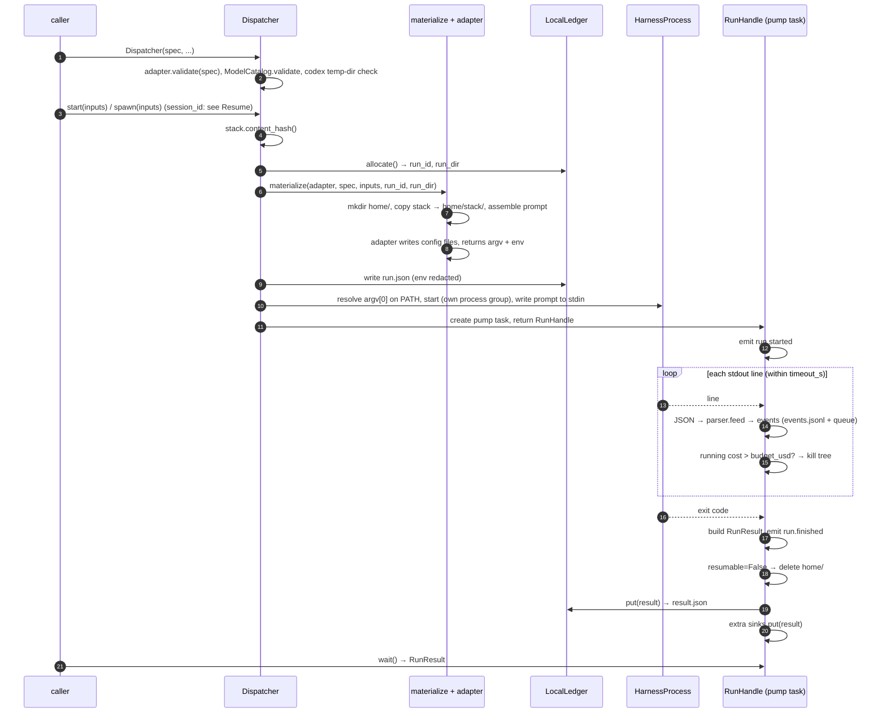

# Run lifecycle

This page follows one run from `Dispatcher(...)` to the ledger: validation, planning, materialization, launch,
stream parsing, result and sinks; the run-directory layout; the resume flow and what must persist for it; and how
cancel, timeout, budget, stream overflow and interrupts end a run.

## Overview



## Steps

| # | Step | Code | Can raise (pre-launch) |
|---|---|---|---|
| 1 | **Validate** in `Dispatcher.__init__`: adapter checks (hooks, output_schema, warnings), model catalogue, codex temp `runs_root` | `execution/dispatcher.py` | `HookUnsupported`, `UnsupportedFeature`, `ModelNotSupported`, `InvalidRunsRoot` |
| 2 | **Plan**: with `session_id`, find and check the session ([Resume](#resume)); hash the stack (pinned now: this is what runs), allocate `<runs_root>/<run_id>/` | `Dispatcher._plan` | `UnsupportedFeature`, `NotResumable`, `OSError` |
| 3 | **Materialize**: create `home/` (or, [resuming](#resume), clear the PHD-owned paths of the session's home), copy the whole stack to `home/stack/`, assemble the prompt, let the adapter write its files and return `argv` and `env`; write `run.json` | `materialize/__init__.py`, adapters | `MissingCredentials`, `MissingSecret` |
| 4 | **Launch**: resolve `argv[0]` (or use `executables[harness]`), start the process in `Spec.cwd` with the stripped host env plus `env`, stdout/stderr piped, stdin written in the background | `RunHandle.launch`, `execution/process.py` | `HarnessNotInstalled` |
| 5 | **Stream / parse**: read stdout line by line; non-JSON lines become `log` events; JSON objects go to the harness parser, which yields normalized events and accumulates the outcome; stderr is copied to `stderr.log` | `RunHandle._consume` | never (data) |
| 6 | **Result**: decide the error (precedence below), build `RunResult`, emit `run.finished`; delete `home/` if `resumable=False` | `RunHandle._build_result` | never (data) |
| 7 | **Sinks**: `LocalLedger.put` writes `result.json` atomically, then each extra sink | `RunHandle._pump` | never: sink errors become warnings |

`plan(inputs)` runs steps 2 and 3 only. Note that a `HarnessNotInstalled` at step 4 leaves a run directory with
`run.json` and `home/` but no `result.json`.

## Run directory

```
<runs_root>/<run_id>/          runs_root defaults to ~/.phd/runs; run_id = YYYYmmdd-HHMMSS-<6 hex> (local time)
  run.json                     launch record, written before launch (also by plan())
  events.jsonl                 one normalized Event per line
  stderr.log                   the harness's stderr, raw
  result.json                  the RunResult, written after the run
  home/                        the isolated config home (absent for resumed turns, which use the session's
                               home, and after resumable=False)
```

| File | Written by | Contents |
|---|---|---|
| `run.json` | `Dispatcher` (plan / start) | `run_id`, `harness`, `model`, `cwd`, `argv`, `env` (values of names matching `TOKEN`, `KEY`, `AUTH_CONTENT`, `SECRET`, `PASSWORD` replaced by `<redacted>`), `stdin` (the full first message), `warnings`, `session_id` (the session being resumed, else `null`), `resumed_from`, `home`, `rules_text` (the session's rules block content, or `null`) |
| `events.jsonl` | `RunHandle` | `{"run_id", "harness", "type", "data", "ts", "raw"}` per line ([events](results-and-events.md#events)) |
| `stderr.log` | `HarnessProcess` | unfiltered stderr bytes |
| `result.json` | `LocalLedger.put` | `RunResult.to_dict()` |
| `home/` | materialize + the harness | see [Harnesses](harnesses.md) |
| `hook.log` | **not PHD**: the test stack's `guard.py` writes it under `$PHD_RUN_DIR`; your hooks can do the same | |

## Resume

A run continues a harness session when `start`, `spawn` or `plan` get `session_id=` (a value from a previous
`RunResult.session_id`). Everything except the harness's own session data comes from the **new** `Spec`.

```mermaid
sequenceDiagram
    participant U as caller
    participant D as Dispatcher
    participant L as LocalLedger
    participant M as materialize + adapter
    U->>D: start(inputs, session_id=sid) / spawn(inputs, session_id=sid)
    D->>D: inputs.rules set? → UnsupportedFeature (nothing written)
    D->>L: latest_for_session(sid) → previous RunResult (latest started_at)
    D->>D: found? same harness? home inside this ledger, no links? exists? same cwd? run.json? (else NotResumable, nothing written)
    D->>L: allocate() → new run_id, run_dir (no home/ of its own)
    D->>M: materialize(..., home=previous.home_dir)
    M->>M: delete PHD-owned paths in the home, write them again from the new Spec
    D->>D: argv = adapter.resume_argv(fresh argv, sid, spec); stack changed? → warning
    D->>L: write run.json (session_id, resumed_from = previous.run_id)
    D->>D: launch in spec.cwd with the shared home, stdin = first message from inputs
```

Checks, in this order, all made before anything is written:

| Check | Why | If it fails |
|---|---|---|
| `inputs.rules` is `None` | rules belong to the session: the ones it started with are re-applied on every turn | `UnsupportedFeature` ("rules cannot be passed when resuming a session") |
| a finished run in **this** dispatcher's ledger has `RunResult.session_id == session_id` | PHD finds the session's home through the ledger; the latest such run (by `started_at`) is used, whatever its status | `NotResumable` ("no finished run with session") |
| that run's harness is `spec.harness` | sessions are harness-specific | `NotResumable` ("belongs to") |
| its `home_dir` is `<runs_root>/<run_id>/home` of a run in this ledger (resolved; the run dir has a `run.json`) and not a symlink or junction | `home_dir` is read from `result.json`, and resuming deletes PHD-owned paths under it | `NotResumable` ("is not a run home", "is a symlink or junction") |
| its `home_dir` still exists | the home holds the harness session (claude `CLAUDE_CONFIG_DIR`, codex `CODEX_HOME`, opencode `XDG_DATA_HOME`) | `NotResumable` ("no longer exists"); happens after `resumable=False` |
| no PHD-owned path in the home (or a parent of one inside it) is a symlink or junction | deletion must never leave the home | `NotResumable` ("is a symlink or junction") |
| its `cwd` is `spec.cwd` | claude keys sessions by working directory | `NotResumable` ("ran in cwd") |
| the session run's `run.json` exists | it carries the session's `rules_text` | `NotResumable` ("has no run.json") |

Details:

- Each resumed turn gets a **new** `run_id` and run directory (`run.json`, `events.jsonl`, `stderr.log`,
  `result.json`) but **no** `home/` of its own: `RunResult.home_dir` is the shared home, and `resumed_from` is
  the run the session was found in (for a chain, the previous turn). Chains work because the lookup always takes
  the latest run of the session.
- The first message is built from `inputs` exactly as for a fresh run (`# Task brief` and/or `# Message`), so a
  resumed turn can carry a brief.
- **Rules persist for the session's lifetime.** The fresh run that starts a session records its rules block as
  `rules_text` in `run.json` (the stripped rules file text, or `null`), and every resumed turn copies it forward
  into its own `run.json`. The system prompt of a resumed turn is the current stack's identity, then the
  session's rules block, then project context per the new `Spec.project_config`, exactly as a fresh run lays it
  out. So codex and opencode, which re-read `AGENTS.md` / `instructions` on every launch, behave like claude.
- `argv` is this materialization's fresh argv plus the harness's resume flag (claude `--resume <sid>`, opencode
  `--session <sid>`; codex rebuilds `codex exec resume <sid> ...` from the fresh flags, without `-C`). Resume flags
  never accumulate along a chain.
- `stack_hash` is the hash of the stack in the new `Spec` (the home's stack copy is replaced). If the stack ref
  (`name@version`) differs from the previous run's, the result gets a warning; the turn still runs.
- A resumed run never deletes the shared home, even if `Spec.resumable` is `False` (and its `resumable` is `True`
  whenever it has a session id). A fresh run with `resumable=False` still deletes its home, ending the chain.
- `plan(inputs, session_id=...)` previews a resumed turn without modifying the session: the checks run, the
  session's rules are applied and `argv` carries the resume flag, but everything is written into the plan's own
  `<run_dir>/home`; the shared home is never touched (so the preview's `env` points at the preview home).

### What a resumed turn reuses vs takes from the new Spec

| Reused from the session | Taken from the new `Spec` (and `Inputs`) |
|---|---|
| the harness's session data in the home: claude `projects/`, `.claude.json` and anything else Claude writes; codex `sessions/`, `*.sqlite`, logs; opencode `data/`, `state/` and what it installs under `config/` | everything PHD writes: the stack copy (`home/stack/`), the hook runtime (`home/phd/`, incl. `shim_config.json`), skills, the system-prompt / `AGENTS.md` file (identity and project context; the rules block is the session's), MCP config, `settings.json` / `config.toml` / `opencode.json` (autonomy, permissions, builtin suppression, merged `harness_config`), codex `hooks.json` and `output-schema.json`, opencode's hook plugin, credentials |
| the session's rules (`rules_text`, re-applied to the system prompt) | the whole argv (model, autonomy flags, budget flag, schema) and env, built fresh |
| | `cwd` (must equal the session's), `timeout_s`, `budget_usd`, `secrets`, `runs_root`, sinks |

PHD-owned directories (skills, `stack/`, `phd/`) are deleted and copied again, so a skill or hook removed from the
stack disappears; PHD-owned files are overwritten or removed. Nothing else in the home is touched. Rules cannot be
changed on a resumed turn (start a new session for new rules); the session's rules are written back into the
system prompt every time. A changed identity or project context does take effect in the rewritten file; how a
harness treats a system prompt that changes mid-session is up to the harness.

Hooks on a resumed turn log to the **new** run: `shim_config.json` is rewritten, so hooks receive the new
`run_id` and `PHD_RUN_DIR`.

## How a run ends

| Trigger | What PHD does | `error.kind` / status |
|---|---|---|
| harness exits normally | waits for exit, builds the result from the parser outcome | none → `succeeded`, or the parser's error |
| `await handle.cancel()` | sets a flag, kills the process tree, waits | `cancelled` / `cancelled` |
| `timeout_s` elapses (measured from the start of streaming; covers the stdin write) | kills the tree, waits | `timeout` / `timed_out` |
| streamed cost > `budget_usd` | kills the tree as soon as the parser's running cost exceeds the budget (opencode: after any `step_finish`; claude: only at its final `result` line, since that is where it reports cost) | `budget` / `budget_exceeded` |
| a stdout line longer than 16 MiB | marks overflow, kills the tree | `stream_overflow` / `failed` |
| an exception inside PHD while streaming or building the result | kills the tree, still returns a (minimal) result | `phd_internal` / `failed` |
| the pump task is cancelled or interrupted (`KeyboardInterrupt`, `asyncio.CancelledError`, e.g. Ctrl-C during `spawn()`) | kills the tree if still running and re-raises; **no result is built and no `result.json` is written** | none |

Precedence when several apply is listed in [Results and events](results-and-events.md#error-kinds-and-precedence).
`RunHandle.wait()` is shielded: cancelling the task that awaits it does not stop the run; call `cancel()`.

## Process-tree kill

The harness is started in its own process group so the whole tree (the CLI, its MCP servers, shell commands) can
be killed.

| | Windows | POSIX |
|---|---|---|
| start | `CREATE_NEW_PROCESS_GROUP` | `start_new_session=True` |
| kill | `taskkill /PID <pid> /T /F`; if that fails and the process still runs, `Process.kill()` | `os.killpg(pid, SIGKILL)` |
| limitation | if the direct child has already exited, `taskkill` cannot walk its tree, so surviving descendants are orphaned (a Job Object would fix this; not implemented) | none known |

Waiting for exit polls the return code every 50 ms instead of `Process.wait()`, because a descendant that still
holds stdout/stderr open would otherwise hang the wait; the stderr copier then gets up to 5 s to finish.

## Host environment stripping

The child environment is `os.environ` minus every variable whose upper-cased name starts with `ANTHROPIC_`,
`CLAUDE_`, `CODEX_`, `OPENAI_`, `OPENCODE_` or `XDG_`, then updated with the adapter's `env`. Everything else
(`PATH`, `HOME`, `USERPROFILE`, other tokens such as `GITHUB_TOKEN`) is passed through. See
[Security and isolation](security-and-isolation.md).

---

**Next:** [Results and events](results-and-events.md) · **See also:** [Harnesses](harnesses.md), [Troubleshooting](../troubleshooting.md)
