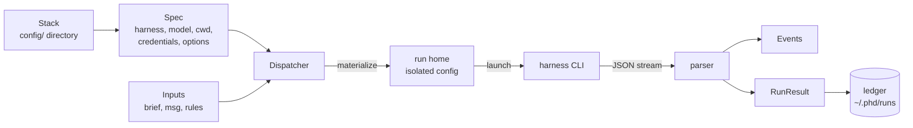

# poly-harness-dispatcher (PHD)

This page says what PHD is, what is built today and what is only planned, and lists every documentation page.

PHD is a Python SDK (package `phd`, Python 3.12+, no runtime dependencies) that runs a headless AI coding agent
through one of three command-line *harnesses*, Claude Code (`claude -p`), Codex (`codex exec`) and OpenCode
(`opencode run`), from a single harness-neutral description, and returns one normalized result.



## Built vs planned

| Component | State | Where |
|---|---|---|
| Core spawner: `Spec` + `Stack` + materializer + launcher + collector, local run ledger | **Built** (layer 1). Runs on the host with **no sandbox**. | `src/phd/`, this documentation |
| Stack resolver (stacks from several sources, URLs, archives; local store) | **Built** | `src/phd/stacks/`, [Stack resolver](concepts/stack-resolver.md) |
| API (FastAPI surface over the spawner) | Planned, not designed | [Architecture](architecture.md#roadmap-components) |
| BaseMCP (user chat + artifact tools for agents) | Tentative, not designed | [Architecture](architecture.md#roadmap-components) |
| Sandboxing (container and/or microVM) | Planned, not designed | [Architecture](architecture.md#roadmap-components) |
| Memory (knowledge-graph project/agent memory) | Planned, not designed | [Architecture](architecture.md#roadmap-components) |

## Thirty-second example

```python
from phd import Credentials, Dispatcher, Inputs, Spec, Stack

spec = Spec(harness="claude", model="sonnet", stack=Stack.load("path/to/config"),
            cwd="path/to/repo", credentials=Credentials.from_host("claude"))
result = Dispatcher(spec).spawn(Inputs(msg="List your skills."))
print(result.status, result.result_text)
```

## Table of contents

**Start here**

- [Getting started](getting-started.md): install, authenticate each harness, first agent (script and notebook), tests, dry runs.

**Concepts**

- [Stacks](concepts/stacks.md): the `config/` directory: `stack.json`, the agent file, skills, `.mcp.json`, hooks, validation, `content_hash`.
- [Stack resolver](concepts/stack-resolver.md): compose a stack from local paths and URLs; the manifest, clash rules, the store and its dedupe rules.
- [Spec, Inputs, Credentials](concepts/spec-and-inputs.md): every field, its default, validation and effect.
- [Harnesses](concepts/harnesses.md): per-harness reference: config home, argv, env, materialization, resume, cost, quirks.
- [Prompt assembly](concepts/prompt-assembly.md): what goes in the system prompt and the first user message.
- [Hooks](concepts/hooks.md): neutral hook events and tools, translation, the shim, exit codes.
- [Run lifecycle](concepts/run-lifecycle.md): plan, materialize, launch, stream, result, ledger; run directory; resume; cancel and timeouts.
- [Results and events](concepts/results-and-events.md): every `RunResult` field, status and error kinds, events per harness, ledger and sinks.
- [Option combinations](concepts/combinations.md): matrices of what each harness does for each option.
- [Security and isolation](concepts/security-and-isolation.md): what is hermetic today, what is not protected, secret handling.

**Design**

- [Architecture](architecture.md): package layout, dependency order, data flow, and the roadmap components.
- [Design record](CoreDesign.md): the original layer-1 design and spike results (`docs/CoreDesign.md`). Where it and the code disagree, the code and these pages are authoritative.

**Reference**

- [Troubleshooting](troubleshooting.md): every `PhdError`, common failure kinds, Windows notes.
- [API reference](reference/index.md): [Spec and stack](reference/spec.md), [Stack resolver](reference/stacks.md), [Dispatcher](reference/dispatcher.md), [Results](reference/results.md), [Models](reference/models.md), [Errors](reference/errors.md).

---

**Next:** [Getting started](getting-started.md)
